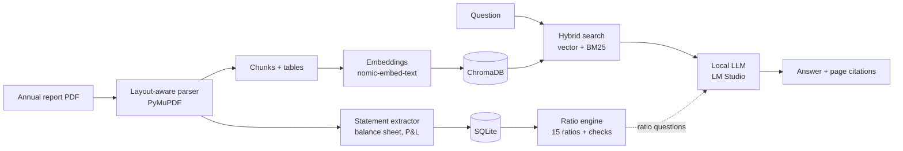

# Financial Document Analyst

A local, privacy-first AI tool that answers questions about annual reports with **page-level citations** and computes **financial ratios with code, not with the LLM**.

No API keys. No cloud. Your documents never leave your machine.

<!-- Add screenshots to docs/ and uncomment:


-->

## What it does

| Feature | How |
|---|---|
| Ask questions about annual reports | Hybrid retrieval (vector + BM25) over the PDF, answered by a local LLM |
| Verifiable answers | Every answer cites `[document p.PAGE]`, and a Sources panel shows the exact text used |
| Ratio calculator | Balance sheet and P&L are extracted by code (standalone and consolidated), then 15 ratios are computed with plain Python formulas |
| Trust checks | Accounting cross-checks (for example Assets = Equity + Liabilities) flag extraction mistakes. Every number is editable and shows its source page |
| Fully local | LM Studio + ChromaDB + SQLite on a laptop (tested on 8 GB VRAM) |

## Architecture



## Design decisions

- **The LLM never does the maths.** Numbers are extracted by code and ratios are computed in Python. For ratio questions the LLM only receives the finished values and quotes them.
- **Two-page spreads are read half by half.** Many annual reports are laid out as spreads. A plain parser interleaves the left and right pages, which scrambled tables. Splitting each spread fixed retrieval of notes like related-party transactions.
- **Hybrid search.** Vector search finds meaning, BM25 finds exact terms such as "related party". Results are merged with reciprocal rank fusion.
- **Human in the loop.** The Ratios view shows extracted line items with source pages so an analyst can verify or correct them.

## Quick start

1. Install [LM Studio](https://lmstudio.ai) and download:
   - an embedding model: `nomic-embed-text-v1.5`
   - a chat model, for example `Gemma` or `Qwen2.5 7B Instruct` (Q4_K_M or Q5_K_M fits 8 GB VRAM)
2. In LM Studio's Developer tab, load both models, set context length to 8192 or 16384, and start the server (default `http://localhost:1234`).
3. Install and run:
   ```
   pip install -r requirements.txt
   streamlit run app.py
   ```
4. Upload a text-based annual report PDF and click **Index uploaded PDFs**. Indexing a 170-page report takes several minutes once, then the index is saved.

If your embedding model has a different identifier in LM Studio:
```
set EMBED_MODEL=your-embedding-model-id      (Windows)
export EMBED_MODEL=your-embedding-model-id   (Mac/Linux)
```

## Evaluation

Tested on the Britannia Industries Annual Report 2025-26 (standalone and consolidated statements).

| Check | Result |
|---|---|
| Question set (numbers, lookups, related-party disclosures, ratios, unanswerable "trap" questions) | **[X] of [Y] correct** |
| Accounting cross-checks on extracted statements (2 bases x 2 years x 4 checks) | 16 of 16 pass |
| Statement extraction time | about 3 seconds |

## Ratios included

- **Liquidity:** current ratio, quick ratio, cash ratio
- **Leverage:** debt-to-equity, liabilities-to-assets, interest coverage
- **Profitability:** gross margin, EBITDA margin, net margin, ROE, ROA
- **Efficiency:** asset turnover, inventory days, receivable days, payable days

The formula is shown next to every ratio in the app.

## Limitations

- Built and tested on Indian Ind AS style annual reports. Banks and NBFCs use a different balance sheet and are not supported yet.
- No OCR: scanned PDFs are detected and flagged but not read.
- Small local models can make mistakes on long, multi-step questions. Always check the Sources panel.
- Gross margin uses COGS = materials consumed + purchases + changes in inventories, which suits manufacturers.

## Roadmap

- Reranker for retrieval
- Multi-year and multi-company comparison
- Cash flow metrics (operating cash flow, free cash flow)
- OCR for scanned reports using a vision model

## Project structure

```
app.py          Streamlit UI (Chat and Ratios views)
rag.py          parsing, chunking, embeddings, hybrid retrieval, generation
ratios.py       statement extraction, ratio formulas, sanity checks, SQLite storage
requirements.txt
```

## Tech stack

Python, Streamlit, PyMuPDF, ChromaDB, rank-bm25, SQLite, LM Studio (OpenAI-compatible API), nomic-embed-text-v1.5, local LLMs (Gemma, Qwen).
